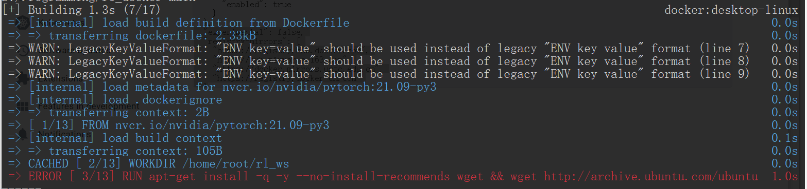
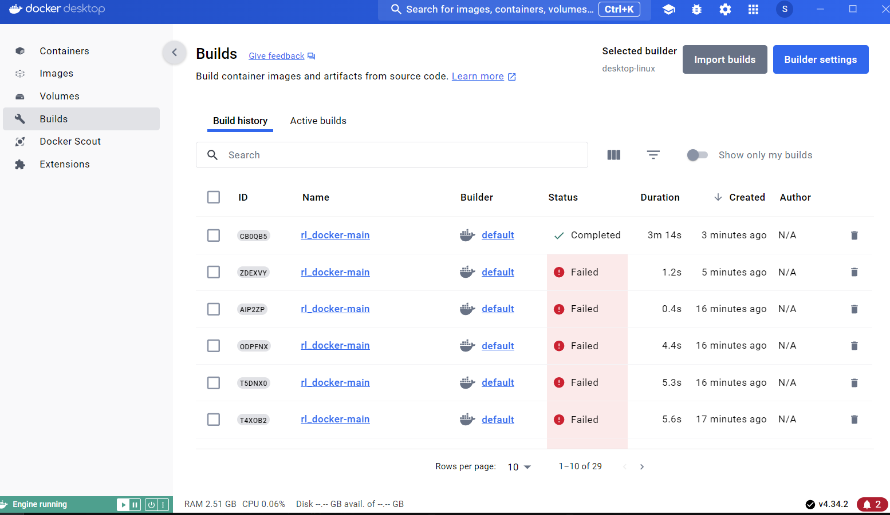
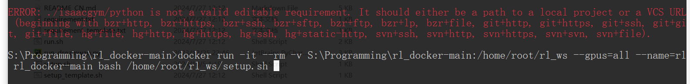
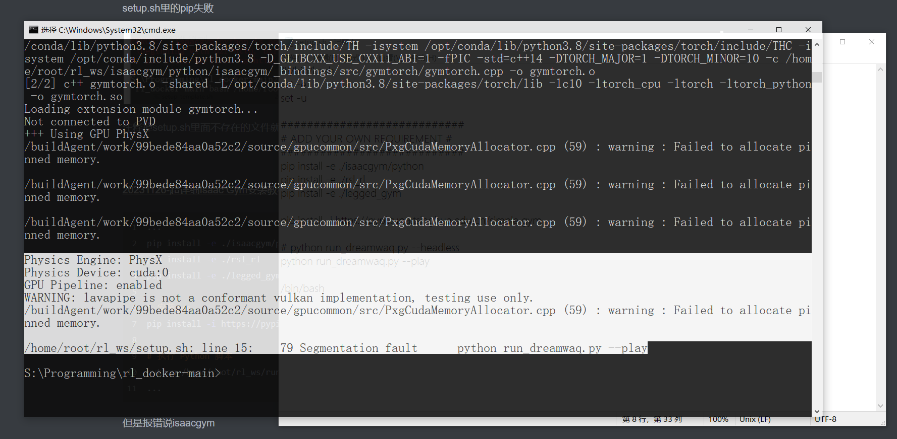

These are my October 2024 notes from getting DreamWaQ running in a Docker/WSL environment. The package versions below describe that setup.

## A Docker daemon that would not start

The first failure was:

```text
Job for docker.service failed because the control process exited with error code.
```

In my case, the cause was a `daemon.json` file I had created manually. Removing that configuration let Docker start again. A more recoverable way to repeat the diagnosis is to move the file aside before restarting:

```bash
sudo mv /etc/docker/daemon.json /etc/docker/daemon.json.backup
sudo systemctl start docker
```

This was a configuration-specific fix, not a reason to discard an existing working daemon configuration. The [discussion that helped me diagnose it](https://blog.csdn.net/zwlww1/article/details/129624289) covers the same startup error.

## Registry access during the image build

The Dockerfile used NVIDIA's PyTorch image:

```dockerfile
FROM nvcr.io/nvidia/pytorch:21.09-py3
```

The build failed before executing its instructions:

```text
ERROR [internal] load metadata for nvcr.io/nvidia/pytorch:21.09-py3
failed to do request: Head "https://nvcr.io/v2/nvidia/pytorch/manifests/21.09-py3":
read: connection reset by peer
```

I separated the image download from the build to make the network problem easier to diagnose:

```bash
docker pull nvcr.io/nvidia/pytorch:21.09-py3
docker info
```

My original scratch command appended a `--registry-mirror` option to `docker pull`; that is not a valid option for this command. Mirror settings belong in Docker's daemon configuration, and a Docker Hub mirror does not necessarily proxy NVIDIA's `nvcr.io` registry. See this [related NVIDIA image-download discussion](https://github.com/ifzhang/ByteTrack/issues/189).

After editing a valid daemon configuration, restart the service:

```bash
sudo service docker restart
```

I also cleared unused build cache while debugging:

```bash
sudo docker builder prune
```

Then I rebuilt with host networking. Run this from the checkout containing the Dockerfile:

```bash
docker build --network host -t rl_docker-main -f Dockerfile .
```

## A pinned Ubuntu package had disappeared

The next failure occurred while downloading a certificate package from the Ubuntu archive.



The Dockerfile contained:

```dockerfile
RUN apt-get install -q -y --no-install-recommends wget \
    && wget http://archive.ubuntu.com/ubuntu/pool/main/c/ca-certificates/ca-certificates_20230311ubuntu0.20.04.1_all.deb
```

I checked the [Ubuntu archive](https://archive.ubuntu.com/ubuntu/pool/main/c/ca-certificates/) and [Aliyun mirror](https://mirrors.aliyun.com/ubuntu/pool/main/c/ca-certificates/). The exact pinned file was no longer available. In this Ubuntu 20.04 build, switching to the package then present in the archive resolved it:

```dockerfile
RUN wget http://mirrors.aliyun.com/ubuntu/pool/main/c/ca-certificates/ca-certificates_20240203~20.04.1_all.deb \
    && dpkg -i ./ca-certificates_20240203~20.04.1_all.deb
```

That filename records the version I used at the time; an archive may change again.



## Passing the GPU and project directory into the container

Another message was:

```text
WARNING: The NVIDIA Driver was not detected. GPU functionality will not be available.
```

The runtime command needs GPU access and a mount of the project directory. From a WSL shell in the project checkout, the equivalent of my original Windows-path command is:

```bash
docker run -it --rm \
  -v "$PWD:/home/root/rl_ws" \
  --gpus=all \
  --name=rl \
  rl_docker-main \
  bash /home/root/rl_ws/setup.sh
```

Useful background references were a [Docker project walkthrough](https://blog.csdn.net/eye123456789/article/details/120879982) and a [WSL2 installation guide](https://blog.csdn.net/weixin_45840825/article/details/127138564).

## Installing the local packages

The setup script then failed because some directories it expected had not been downloaded yet.



The missing paths were dependencies to obtain, rather than arbitrary lines to remove. Once Isaac Gym and the other repositories were in place, the relevant steps were:

```bash
pip install -e ./isaacgym/python
pip install -e ./rsl_rl
pip install -e ./legged_gym
pip install -i https://pypi.tuna.tsinghua.edu.cn/simple gym
python /home/root/rl_ws/run_dreamwaq.py --headless
```

I used this [Isaac Gym installation reference](https://blog.csdn.net/m0_37802038/article/details/134629194) along the way.


