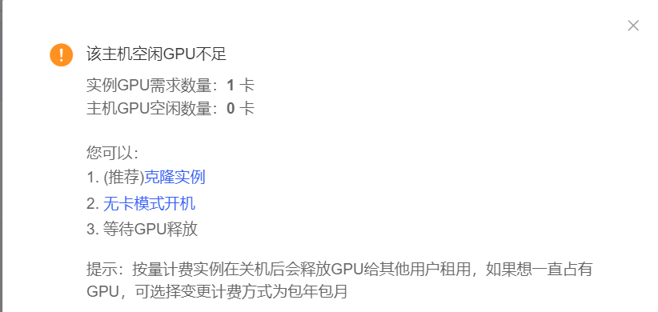
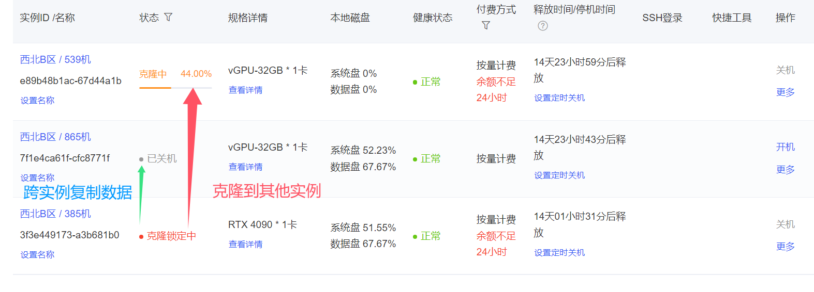

For my experiments, I tried both AutoDL and [GPUShare](https://gpushare.com/). GPUShare offered a [student-verification process](https://gpushare.com/center/account/student) worth checking at the time. The [AutoDL documentation](https://www.autodl.com/docs) was my main reference for instance management.

## Restarting and cloning an instance

I found that restarting an existing instance depended on GPU availability on its original host, rather than free GPUs elsewhere in the region. That made it easy to have an intact environment but no immediately available GPU on that particular machine.

The cloning feature let me copy the system and data disks to another instance in the same region. My notes recorded a limit of three clones per day at the time; that is a historical observation, not a statement of the platform's current quota.



## Copying data between instances

Cross-instance copying was another way to move a prepared environment or experiment data to an available instance without starting the setup from scratch.



My original notebook also contained Docker commands copied from an unrelated setup. The relevant Docker troubleshooting is now kept in the [DreamWaQ and Docker note](/blog/2024/1/).

## Match the OpenVLA command to the checkout

The more useful lesson from this notebook was that similarly named fine-tuning scripts can expose different command-line options. A command using `--use_l1_regression`, `--use_diffusion`, or `--use_proprio` does not necessarily work with the original OpenVLA fine-tuning script.

I recorded the following extended-interface run for a LIBERO goal dataset:

```bash
torchrun --standalone --nnodes 1 --nproc-per-node 1 vla-scripts/finetune.py \
  --vla_path openvla/openvla-7b \
  --data_root_dir /root/autodl-tmp/openvla/dataset/ \
  --dataset_name libero_goal_no_noops \
  --run_root_dir /root/autodl-tmp/openvla/log/ \
  --use_l1_regression True \
  --use_diffusion False \
  --use_film False \
  --num_images_in_input 2 \
  --use_proprio True \
  --batch_size 8 \
  --learning_rate 5e-4 \
  --num_steps_before_decay 100000 \
  --max_steps 150005 \
  --save_freq 10000 \
  --save_latest_checkpoint_only False \
  --image_aug True \
  --lora_rank 32 \
  --wandb_entity YOUR_WANDB_ENTITY \
  --wandb_project YOUR_WANDB_PROJECT
```

However, the help output from a different checkout listed `--save_steps`, `--grad_accumulation_steps`, `--adapter_tmp_dir`, `--use_lora`, and `--use_quantization`, without those extended action-head options. I adjusted the command to that interface:

```bash
torchrun --standalone --nnodes 1 --nproc-per-node 1 vla-scripts/finetune.py \
  --vla_path /root/autodl-tmp/openvla/openvla-7b \
  --data_root_dir /root/autodl-tmp/openvla/dataset/modified_libero_rlds/ \
  --dataset_name libero_object_no_noops \
  --run_root_dir /root/autodl-tmp/openvla/log/ \
  --adapter_tmp_dir /root/autodl-tmp/openvla/log/ \
  --lora_rank 32 \
  --batch_size 2 \
  --grad_accumulation_steps 1 \
  --learning_rate 2.5e-4 \
  --image_aug True \
  --wandb_project YOUR_WANDB_PROJECT \
  --wandb_entity YOUR_WANDB_ENTITY \
  --save_steps 5000 \
  --max_steps 30000 \
  --save_latest_checkpoint_only true
```

For the extended interface, I also saved a smaller-batch variant using local model weights:

```bash
torchrun --standalone --nnodes 1 --nproc-per-node 1 vla-scripts/finetune.py \
  --vla_path ./weight/openvla-7b \
  --data_root_dir ../modified_libero_rlds/ \
  --dataset_name libero_goal_no_noops \
  --run_root_dir ./log \
  --use_l1_regression True \
  --use_diffusion False \
  --use_film False \
  --num_images_in_input 2 \
  --use_proprio True \
  --batch_size 4 \
  --learning_rate 5e-4 \
  --num_steps_before_decay 100000 \
  --max_steps 150005 \
  --save_freq 10000 \
  --save_latest_checkpoint_only True \
  --image_aug True \
  --lora_rank 32
```

The `/root/autodl-tmp` paths reflect the rented container's storage layout. Replace them with the paths for the actual instance, and inspect `python vla-scripts/finetune.py --help` before choosing among these examples. These notes record launch configurations, not a completed evaluation of the trained policies.
