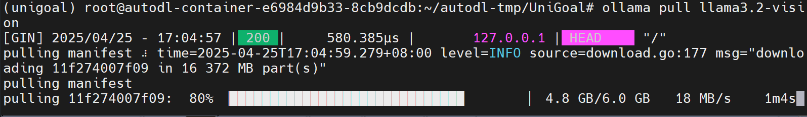

This notebook documents my attempt to reproduce [UniGoal](https://github.com/bagh2178/UniGoal), a universal zero-shot goal-navigation framework. UniGoal is the work being reproduced here; the method and benchmark results in the introduction are not my own contributions.

## What the method does

UniGoal represents both the observed environment and the requested goal as graphs, allowing object categories, target images, and text descriptions to share a navigation pipeline. RGB-D observations update the scene graph, while language and vision-language models help form the goal representation.

The exploration policy changes with the degree of graph matching. With no useful match, it explores using decomposed subgraphs; with a partial match, it projects coordinates and aligns anchors to infer a promising target location; with a full match, it checks and refines the localization. A record of unsuccessful regions reduces repeated visits.

The [overview I read](https://zhuanlan.zhihu.com/p/30973430092) described comparisons on Matterport3D and HM3D against methods including Mod-IIN, SG-Nav, and GOAT. It quoted success rates of 41.0% for object navigation, 60.2% for instance-image navigation, and 20.2% for text navigation. Those figures are reported context from that overview, not results reproduced by the installation steps below; comparisons require the original paper's exact task and evaluation settings.

## Create the environment

The rented base image advertised PyTorch 2.5.1, Python 3.12, Ubuntu 22.04, and CUDA 12.4. The older Habitat stack required a separate Python 3.8 environment:

```bash
git clone https://github.com/bagh2178/UniGoal.git
cd UniGoal
conda create -n unigoal python=3.8
conda activate unigoal
```

On the AutoDL image, I used its network helper when available and removed stale proxy variables from the shell:

```bash
source /etc/network_turbo
unset http_proxy https_proxy
```

That helper is platform-specific; it is not a standard Linux configuration file.

## Install Habitat Sim and Habitat Lab

```bash
conda install habitat-sim==0.2.3 withbullet headless \
  -c conda-forge -c aihabitat --override-channels
pip install -e third_party/habitat-lab
```

The original note accidentally split `withbullet headless --override-channels` onto a separate line. They belong to the Conda command. The Python 3.8 requirement here refers to this recorded Habitat environment, not all later Habitat releases.

## Perception and matching dependencies

The navigation stack combined several libraries:

- **LightGlue** performs local feature matching with adaptive computation. It can reduce work for easier image pairs and is relevant to reconstruction and localization.
- **Detectron2** provides object detection, instance segmentation, and related vision components. Building it from source can require substantial host memory.
- **Grounded Segment Anything** combines SAM's promptable segmentation with GroundingDINO's text-guided detection. The pretrained weights make these models useful without training a new detector for every task; “zero-shot” does not mean that the models were never pretrained.
- **Faiss GPU** supplies accelerated vector-similarity search and clustering.

I installed the following dependencies from the project root:

```bash
pip install git+https://github.com/cvg/LightGlue.git
pip install git+https://github.com/facebookresearch/detectron2.git

git clone https://github.com/IDEA-Research/Grounded-Segment-Anything.git \
  third_party/Grounded-Segment-Anything
cd third_party/Grounded-Segment-Anything
git checkout 5cb813f
pip install -e segment_anything
pip install --no-build-isolation -e GroundingDINO
cd ../../
```

Checking out that commit places Git in a detached-HEAD state, which is expected when reproducing a particular revision.

Create the destination directory before downloading the model weights. `wget -O` names the output file; it does not create missing parent directories:

```bash
mkdir -p data/models/
wget -O data/models/sam_vit_h_4b8939.pth \
  https://dl.fbaipublicfiles.com/segment_anything/sam_vit_h_4b8939.pth
wget -O data/models/groundingdino_swint_ogc.pth \
  https://github.com/IDEA-Research/GroundingDINO/releases/download/v0.1.0-alpha/groundingdino_swint_ogc.pth
```

The first file is SAM's ViT-H checkpoint; the second is GroundingDINO's Swin-T checkpoint. My transfer logs recorded approximately 2.39 GB and 662 MB respectively.

```bash
conda install pytorch::faiss-gpu
pip install -r requirements.txt
```

When a configured Conda mirror failed, I also recorded an explicit-channel alternative:

```bash
conda install faiss-gpu -c pytorch -c nvidia -c anaconda --override-channels
```

## Organize the HM3D data

These steps concern the Habitat/UniGoal evaluation environment. Create the expected locations first:

```bash
mkdir -p data/datasets/instance_imagenav/hm3d/v3/
mkdir -p data/scene_datasets/hm3d_v0.2/val/
```

The source archives in my notes were:

- [HM3D instance-image navigation episodes](https://dl.fbaipublicfiles.com/habitat/data/datasets/imagenav/hm3d/v3/instance_imagenav_hm3d_v3.zip)
- [HM3D v0.2 validation scenes](https://mp-app-prod.s3.amazonaws.com/habitat/v1.0/hm3d-val-habitat-v0.2.tar)

Obtain the scene data under its applicable access and license terms. From the episode archive, place `val`, `train`, and `val_mini` under `data/datasets/instance_imagenav/hm3d/v3/`. Place the validation scene directories under `data/scene_datasets/hm3d_v0.2/val/`.

The file and directory names must match what the configuration expects:

```text
UniGoal/
└── data/
    ├── datasets/
    │   └── instance_imagenav/
    │       └── hm3d/
    │           └── v3/
    │               └── val/
    │                   ├── content/
    │                   │   ├── 4ok3usBNeis.json.gz
    │                   │   ├── 5cdEh9F2hJL.json.gz
    │                   │   └── ...
    │                   └── val.json.gz
    └── scene_datasets/
        └── hm3d_v0.2/
            └── val/
                ├── 00800-TEEsavR23oF/
                │   ├── TEEsavR23oF.basis.glb
                │   └── TEEsavR23oF.basis.navmesh
                ├── 00801-HaxA7YrQdEC/
                └── ...
```

## Configure the language and vision-language models

I used Ollama for this setup. Its [Linux installation documentation](https://docs.ollama.com/linux) explains the available installation methods. The command saved in my notebook was:

```bash
curl -fsSL https://ollama.com/install.sh | sh
```

On a rented container, I put downloaded models on the data disk:

```bash
export OLLAMA_MODELS=/root/autodl-tmp/ollama_models
mkdir -p "$OLLAMA_MODELS"
```

Set the variable in your own `~/.bashrc` if you want it in future interactive shells. If Ollama runs as a system service instead, configure its service environment; changing the current shell does not change an already running service.

Containers without systemd may need a manually started server:

```bash
ollama serve &
ollama pull llama3.2-vision
```

Ollama can resume an interrupted model download. A warning about GPU detection still needs to be checked against the actual machine; it does not establish that GPU inference is working.



Alternatively, use your own model API by configuring `llm_model`, `vlm_model`, `api_key`, and `base_url` in `configs/config_habitat.yaml`. Keep an actual API key out of a public configuration file.

## Start evaluation

If no Ollama server is running, start one. `nohup` is an alternative to leaving it attached to the current terminal:

```bash
nohup ollama serve > ollama.log 2>&1 &
netstat -tuln | grep 11434
CUDA_VISIBLE_DEVICES=0 python main.py
```

Do not start a second server if port `11434` is already serving the intended instance. This invocation was for the instance-image-goal setup.

On the first run, loading `bert-base-uncased` failed when Hugging Face was unreachable:

```text
OSError: We couldn't connect to 'https://huggingface.co' to load this file,
couldn't find it in the cached files and it looks like bert-base-uncased
is not the path to a directory containing a file named config.json.
```

For the network conditions of that run, I tried a mirror before restarting the process:

```bash
export HF_ENDPOINT=https://hf-mirror.com
```

## Missing system and Python dependencies

### EGL

Importing Habitat Sim failed with:

```text
ImportError: libEGL.so.1: cannot open shared object file: No such file or directory
```

The Ubuntu packages that resolved this in my environment were:

```bash
sudo apt-get update
sudo apt-get install libegl1 mesa-utils libgl1-mesa-glx
```

### OpenAI client

`src/graph/graph.py` imported the OpenAI client even in this larger navigation setup:

```text
ModuleNotFoundError: No module named 'openai'
```

```bash
pip install openai
```

### MKL and Faiss

Importing Faiss then failed because the expected MKL library was missing:

```text
ImportError: libmkl_intel_lp64.so.1: cannot open shared object file: No such file or directory
```

For this older environment, the recorded fix was:

```bash
conda install mkl=2021
```

### PyTorch3D

The 3D overlap calculation reached `src/graph/utils/iou.py`, imported `pytorch3d.ops`, and failed:

```text
ModuleNotFoundError: No module named 'pytorch3d'
```

I built PyTorch3D from source in the GPU-enabled environment:

```bash
pip install "git+https://github.com/facebookresearch/pytorch3d.git" -v
```

The build ran from about 23:44 to 00:07 in my notes. That duration is specific to the machine and checkout. Compiler warnings alone did not establish failure; the build's final status did. My original command appended a machine shutdown, which is not part of installing the package.

## NumPy arrays and tensor conversion

At two points in `src/graph/graph.py`—lines 878 and 903 in the checkout I used—the code called `.cpu()` on an array that was already a NumPy array:

```text
AttributeError: 'numpy.ndarray' object has no attribute 'cpu'
```

My immediate workaround was:

```python
frontier_locations = torch.tensor(frontier_locations).cpu().numpy()
```

A more explicit conversion avoids constructing a tensor unnecessarily:

```python
if isinstance(frontier_locations, torch.Tensor):
    frontier_locations = frontier_locations.detach().cpu().numpy()
else:
    frontier_locations = np.asarray(frontier_locations)
```

The important point is to know whether each intermediate value is a tensor or an array; the line numbers are only references to that historical checkout.

## Keep frontier scores aligned with the same candidates

The next error was a shape mismatch in `get_goal`, rather than another missing `.cpu()` method:

```text
scores += distances_16_inverse
ValueError: operands could not be broadcast together with shapes (1016,) (934,) (1016,)
```

The two score arrays had been computed over different frontier sets. My patch filtered the candidate positions once, retained those positions as `valid_locations`, and used exactly that set for both distance terms.

The original pasted function had damaged indentation. The reference below restores the intended block structure and retains the method used in the notebook. It depends on the surrounding project's imports and class state and has not been validated against newer UniGoal releases.

```python
def get_goal(self, goal=None):
    fbe_map = torch.zeros_like(self.full_map[0, 0])
    if self.full_map.shape[1] == 1:
        fbe_map[self.fbe_free_map[0, 0] > 0] = 1
    else:
        fbe_map[self.full_map[0, 1] > 0] = 1
        obstacles = skimage.morphology.binary_dilation(
            self.full_map[0, 0].cpu().numpy(),
            skimage.morphology.disk(4),
        )
        fbe_map[obstacles] = 3

    fbe_cp = copy.deepcopy(fbe_map)
    fbe_cpp = copy.deepcopy(fbe_map)
    fbe_cp[fbe_cp == 0] = 4  # Unknown space.
    fbe_cp[fbe_cp < 4] = 0   # Free space and obstacles.
    unknown_boundary = skimage.morphology.binary_dilation(
        fbe_cp.cpu().numpy(), skimage.morphology.disk(1)
    )
    fbe_cpp[unknown_boundary] = 0

    frontier_map = (fbe_map - fbe_cpp) == 1
    frontier_map &= (self.num_of_goal < 3).to(frontier_map.device)
    frontier_locations = torch.stack(torch.where(frontier_map), dim=1)
    if frontier_locations.shape[0] == 0:
        return None

    input_pose = np.zeros(7)
    input_pose[:3] = self.full_pose.cpu().numpy()
    input_pose[1] = self.map_size_cm / 100 - input_pose[1]
    input_pose[2] = -input_pose[2]
    input_pose[4] = self.full_map.shape[-2]
    input_pose[6] = self.full_map.shape[-1]
    traversible, start = self.get_traversible(
        self.full_map.cpu().numpy()[0, 0, ::-1], input_pose
    )

    planner = FMMPlanner(traversible)
    planner.set_goal([start[0] + 1, start[1] + 1])
    fmm_dist = planner.fmm_dist[::-1]

    # Convert once and account for the planner's coordinate offset.
    frontier_locations_np = frontier_locations.cpu().numpy() + 1
    distances = fmm_dist[
        frontier_locations_np[:, 0], frontier_locations_np[:, 1]
    ] / 20

    distance_threshold = 3
    valid_mask = distances >= distance_threshold
    valid_distances = distances[valid_mask]
    valid_locations = frontier_locations_np[valid_mask]
    if len(valid_distances) == 0:
        return None

    scores = 10 - (
        np.clip(valid_distances, 0, 10 + distance_threshold)
        - distance_threshold
    )

    if isinstance(goal, (list, np.ndarray)):
        try:
            planner_goal = FMMPlanner(traversible)
            planner_goal.set_goal([int(goal[0]) + 1, int(goal[1]) + 1])
            fmm_dist_goal = planner_goal.fmm_dist[::-1]

            # Use the same filtered candidates as the first score term.
            goal_distances = fmm_dist_goal[
                valid_locations[:, 0], valid_locations[:, 1]
            ] / 20
            goal_scores = 1 - (
                np.clip(goal_distances, 0, 10 + distance_threshold)
                - distance_threshold
            ) / 10
            scores += goal_scores
        except Exception as error:
            print(f"Goal processing error: {error}")

    if len(scores) == 0:
        return None
    best_idx = np.argmax(scores)
    return valid_locations[best_idx] - 1
```

The coordinate offsets, distance scaling by `20`, and threshold `3` are parameters from that implementation, not universal navigation defaults.

## An unrecognized goal category

Later, `set_goal_cat_id` attempted to look up a category that was absent from the environment's category map:

```text
self.info['goal_name'] = self.index2name[idx]
KeyError: 6
```

In `src/agent/unigoal/agent.py`, my patch checked the proposed category before returning it. The surrounding center-of-image test was retained:

```python
image_height, image_width = self.instance_imagegoal.shape[:2]
box = ins_whwh[0][2]
center_dx = (box[0] + box[2] - image_width) / 2
center_dy = (box[1] + box[3] - image_height) / 2

if center_dx**2 + center_dy**2 < 2 * (image_width / 6)**2:
    cat_id = int(ins_whwh[0][0])
    if cat_id in self.envs.index2name:
        return cat_id
return None
```

This prevents that invalid category from reaching the dictionary lookup. It does not establish that the detector's category mapping is semantically correct; that mapping still needs to agree with the environment.

The notebook ended with a plan to add episode selection in `main.py`, but no implementation was recorded.
