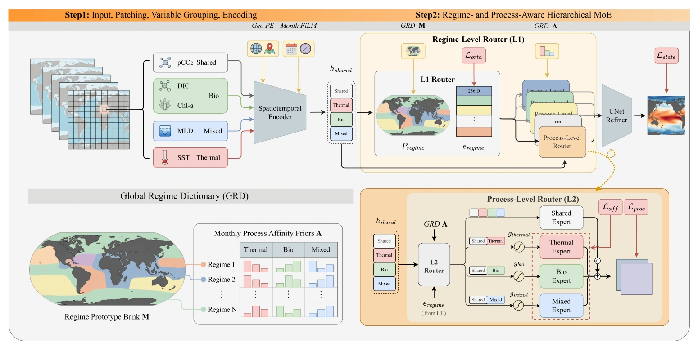

My master's research at the University of Chinese Academy of Sciences, advised by **Prof. Jungang Xu**, includes learning systems for complex physical processes.

[Carbon-ECS](/publications/carbon-ecs/) introduces a 17-year East China Sea benchmark and combines large-scale transport modeling with local detail refinement. [REM-MoE](/publications/rem-moe/) extends this line of work through hierarchical experts that separate environmental regimes from physical mechanisms.

I am interested in representations that make long-horizon physical prediction more reliable and interpretable.

