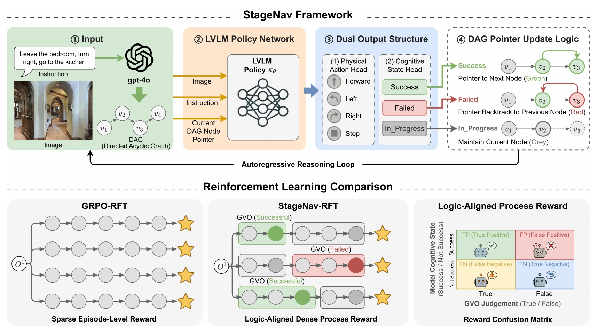

I study how agents represent their progress, use feedback, and recover from mistakes over long horizons.

[StageNav](/publications/stagenav/) uses geometric verification and state-aligned reinforcement learning for long-horizon navigation. [ForesightNav](/publications/foresightnav/) combines semantic mapping, graph-based target verification, and geometric exploration.

My internships at **Baidu** and **ByteDance** have extended this interest to research agents that manage context, plan experiments, and refine models. I am exploring scientific-state representations for autonomous PDE modeling and structured temporal-spatial modeling for ocean prediction; these manuscripts remain under review.

[Research experience](/experience/) · [Publications and manuscripts](/publications/)
